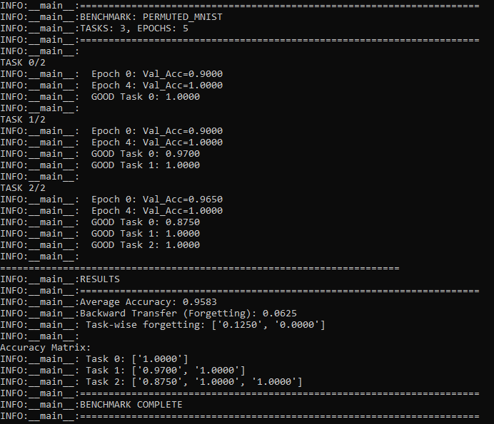

# Baby Dragon Hatchling - Continual

**This fork attempts to extend the original BDH architecture by integrating continual learning with Adaptive Synaptic Consolidation, inspired by biological synaptic plasticity.**

**Based on: Zenke et al. "Continual Learning Through Synaptic Intelligence" (2017)**

```bash
train.py --continual_learning
simple_benchmark.py --benchmark permuted_mnist --num_tasks 3 --epochs 5
```

***

## Benchmarks
Permuted MNIST



***
